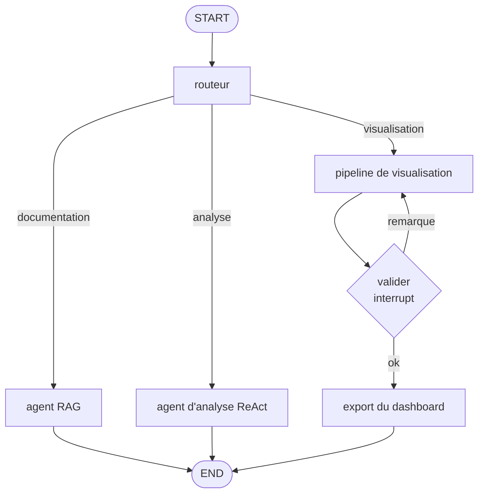
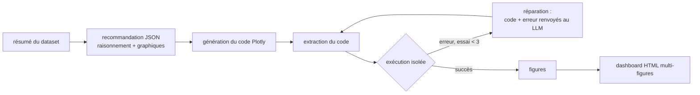

# 03 — Architecture

[← Retour au README](../README.md)

## 1. Vue d'ensemble



L'ensemble est un `StateGraph` compilé **avec un checkpointer** : la mémoire de conversation (par `thread_id`) et la reprise après `interrupt` en dépendent.

## 2. L'état du graphe

Proposition minimale, à adapter :

```python
class EtatAssistant(TypedDict):
    messages: Annotated[list, add_messages]   # historique de la conversation
    destination: str                          # décision du routeur
    figures: list                             # figures Plotly produites
    code: str                                 # dernier code généré
    journal: list[str]                        # essais de la boucle de réparation
    dashboard: str | None                     # chemin du fichier HTML exporté
```

## 3. Le routeur

- Il classe la dernière demande en `documentation`, `analyse` ou `visualisation`.
- Sa sortie est un **modèle Pydantic** dont le **premier champ est un raisonnement** (chain-of-thought), puis la décision :

```python
class Route(BaseModel):
    raisonnement: str = Field(description="En 2 phrases : ce que demande l'utilisateur et quelle source y répond")
    destination: Literal["documentation", "analyse", "visualisation"]
```

- L'arête conditionnelle lit `etat["destination"]`.

## 4. Le serveur MCP

Un serveur unique (`src/mcp_server.py`), lancé en `stdio` par le client `MultiServerMCPClient`. Contrats minimaux :

| Outil | Entrée | Sortie | Rôle |
| --- | --- | --- | --- |
| `resumer_dataset` | `max_lignes: int` (borné) | texte : schéma, types, statistiques, échantillon | donner au LLM une vue du dataset qui tient dans le contexte |
| `statistiques` | colonne, regroupement facultatif, opération (liste fermée) | texte ou tableau court | répondre aux questions chiffrées |
| `chercher_documentation` | `requete: str`, `k: int` (borné) | liste de passages avec leur source (fichier, page) | RAG |

Pour chaque outil : **docstring précise** (c'est le prompt de l'outil), **arguments bornés**, **erreur renvoyée comme message lisible** au lieu d'une exception.

## 5. La branche documentation (RAG)

1. **Indexation** (une fois, `src/rag.py`) : extraction du texte, **découpage** (taille et recouvrement à justifier), embeddings, base vectorielle (ChromaDB). Chaque morceau garde ses métadonnées : fichier et page.
2. **Recherche** : l'outil MCP `chercher_documentation` renvoie les passages les plus proches.
3. **Réponse** : un agent (ou un nœud) qui appelle l'outil, puis répond **en citant ses sources** (fichier, page). S'il ne trouve rien, il le dit.

## 6. La branche analyse

- Un agent **ReAct** (`create_agent`) avec les outils MCP `resumer_dataset` et `statistiques`.
- Un **system prompt** qui fixe au moins : ne jamais donner un chiffre sans l'avoir calculé avec un outil ; dire quand une question dépasse les données.
- Une `recursion_limit`.

## 7. La branche visualisation (pipeline)

Le pipeline est un **workflow**, dans `src/viz_pipeline.py`, appelable **seul** :



| Étape | Exigence |
| --- | --- |
| Recommandation | sortie JSON validée (Pydantic), avec un champ `raisonnement` puis la liste des graphiques (type, colonnes, titre, justification) |
| Génération | le prompt contient le résumé du dataset et la recommandation, **pas les données brutes** |
| Exécution isolée | `exec` dans un espace de noms restreint (`df`, `px`, `go` uniquement) ; refus si le code contient `import os`, `open(`, `subprocess`… |
| Réparation | 3 essais au maximum ; chaque essai est consigné dans un journal |
| Dashboard | plusieurs figures dans **un seul fichier HTML** |

Dans le graphe, la branche se termine par le nœud `valider` : `interrupt` montre le code et un aperçu ; « ok » exporte le dashboard, une remarque relance la génération en tenant compte de la remarque.

## 8. La mémoire

- **Court terme** : checkpointer + `thread_id` (une conversation par onglet Streamlit).
- **Contexte long** : quand l'historique dépasse N messages, un nœud résume les anciens messages et les remplace par ce résumé.

## 9. L'interface Streamlit

- Un champ de saisie et l'historique de la conversation.
- Un `thread_id` conservé dans `st.session_state`.
- Quand le graphe s'arrête sur `interrupt` : afficher le code et l'aperçu, puis un bouton **Valider** et un champ **Remarque**, qui reprennent le graphe avec `Command(resume=...)`.
- L'affichage du dashboard produit.
