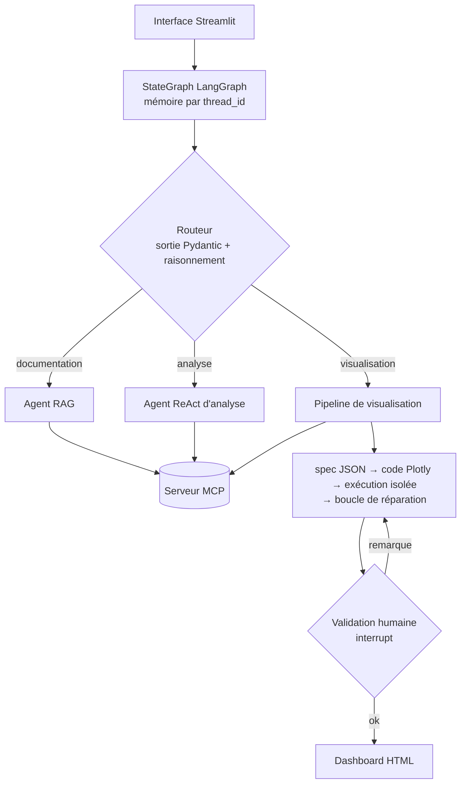

# Mini-projet — Analyste de données augmenté

**Agentic DataViz** et **Agentic AI** · Master 2 I2A · Université Paris 8<br>
**Enseignant :** Pr Mehdi Ammi — Laboratoire LIASD (EA 4383)<br>
**Version :** novembre 2026 · **Travail individuel**

*Note sur l'usage de l'IA : le contenu pédagogique (objectifs, progression, exercices, solutions) a été conçu par l'auteur. Claude Code (Anthropic) a été utilisé pour la mise en forme des documents.*

---

## En une phrase

Vous construisez un assistant qui répond en langage naturel sur un domaine de votre choix : il **cherche dans une documentation** et cite ses sources, **analyse un dataset** pour répondre à une question chiffrée, et **produit automatiquement un dashboard**. Tous ses outils sont servis par **votre serveur MCP**.

Ce projet donne **deux notes sur 20** : une pour **Agentic DataViz**, une pour **Agentic AI**. Il se termine par une **démonstration en direct** : l'enseignant pose ses propres questions à votre assistant, puis vous interroge sur vos choix (voir [08 — Démonstration et questions](docs/08_demonstration.md)).

## Architecture



## Documentation

| Document | Contenu |
| --- | --- |
| [01 — Cahier des charges](docs/01_cahier_des_charges.md) | objectifs, composants à réaliser, règles |
| [02 — Choix des données](docs/02_choix_des_donnees.md) | exigences, exemples, fiche de choix à faire valider |
| [03 — Architecture](docs/03_architecture.md) | graphe, état, routeur, contrats des outils MCP, pipeline |
| [04 — Livrables](docs/04_livrables.md) | code, scénarios de démonstration, rapport |
| [05 — Évaluation](docs/05_evaluation.md) | les deux grilles (DataViz et Agentic AI) et les attendus |
| [06 — Guide technique](docs/06_guide_technique.md) | installation, versions, erreurs fréquentes |
| [07 — Notions et séances](docs/07_notions.md) | où revoir chaque notion dans les deux cours |
| [08 — Démonstration et questions](docs/08_demonstration.md) | déroulement de la démonstration, exemples de questions posées à l'assistant et à l'étudiant |

## Démarrage rapide

```bash
git clone <url-du-depot>
cd mini-projet-analyste-augmente
conda create -n analyste python=3.11 -y && conda activate analyste   # ou : python -m venv .venv
python -m pip install -r requirements.txt
cp .env.example .env              # choisir le modèle (Ollama ou API personnelle)
python src/check_setup.py         # vérifie les bibliothèques et l'accès au LLM
```

Placez vos données dans `data/` (voir [data/README.md](data/README.md)), puis complétez le squelette de `src/`.

## Structure du dépôt

```
mini-projet-analyste-augmente/
├── README.md                 ce fichier
├── docs/                     documentation du projet
├── templates/                fiche de choix, scénarios, rapport (à recopier)
├── src/
│   ├── llm.py                accès au LLM (fourni)
│   ├── check_setup.py        vérification de l'installation (fourni)
│   ├── sortie.py             sortie structurée robuste (fourni)
│   ├── mcp_server.py         serveur MCP — à compléter
│   ├── rag.py                indexation et recherche documentaire — à compléter
│   ├── viz_pipeline.py       pipeline de visualisation — à compléter
│   ├── graph.py              graphe LangGraph, routeur, validation — à compléter
│   └── app.py                interface Streamlit — à compléter
├── data/                     vos données (non commitées si volumineuses)
├── scenarios/                traces de vos 5 scénarios
├── requirements.txt
├── .env.example
└── .gitignore
```

## Calendrier

| Étape | Date |
| --- | --- |
| Validation de la fiche de choix des données | *à préciser* |
| Séance de travail encadrée | *à préciser* |
| Dépôt sur Moodle (lien du dépôt Git, rapport PDF, traces) | *à préciser* |
| Démonstration individuelle (15 min) | *à préciser* |

## Règles essentielles

- Travail **individuel**.
- Modèle local (Ollama) ou API avec votre compte personnel : **activez un plafond de dépense**.
- Le fichier `.env` contient vos clés : **ne le commitez jamais**.
- Toute boucle est **bornée** (essais, `recursion_limit`, `max_tokens`) ; le code généré n'est **jamais** exécuté sans isolation.
