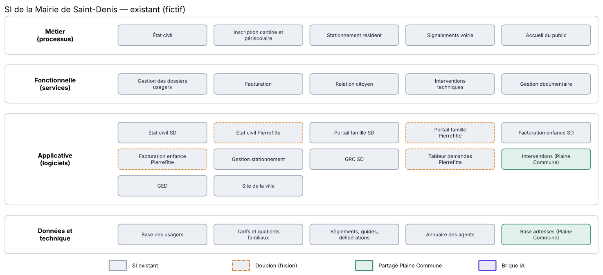
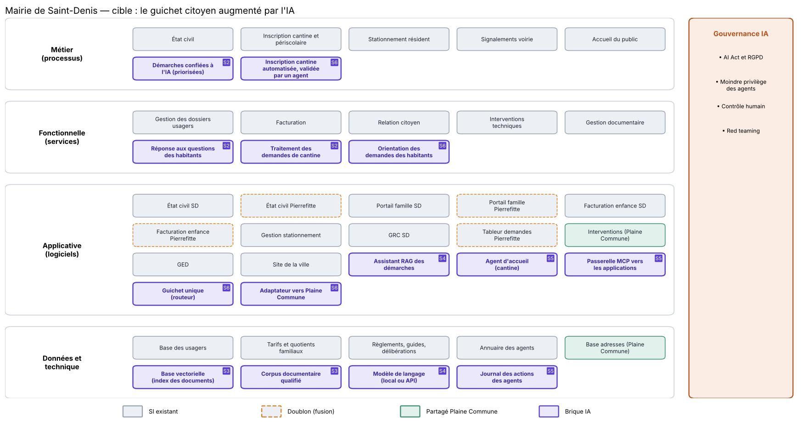

# Séance 1 — IA et SI : quelle articulation ?
**Urbanisation des SI à l'ère de l'IA** · Master 2 CPI · Université Paris 8 
**Enseignant :** Pr Mehdi Ammi — Laboratoire LIASD (EA 4383)

*Note sur l'usage de l'IA : la progression pédagogique et le scénario ont été définis par l'auteur. Claude (Anthropic) a été utilisé pour la rédaction des exercices et la mise en forme des supports.*

Cette séance pose le cadre du cours. Elle ne comporte pas de notebook : l'environnement technique est installé en séance 2.

**Support de cours :** `S1_IA_et_SI.pptx` (35 diapositives, avec notes pour l'enseignant). Ce README en reprend le contenu.

> **🎯 Objectifs de la séance**
> - Comprendre ce qu'est l'urbanisation d'un système d'information et pourquoi elle est nécessaire
> - Connaître les quatre couches d'une cartographie, et la démarche existant → cible → trajectoire
> - Comprendre les trois niveaux d'articulation entre IA et SI, qui structurent le cours
> - Découvrir le fil rouge (la Mairie de Saint-Denis) et produire un premier diagnostic

| Durée | Contenu |
| --- | --- |
| 1 h 15 | Cours : parties 1 à 4 ci-dessous |
| 1 h 15 | Atelier : diagnostic du SI de la Mairie de Saint-Denis (partie 5) |
| 30 min | Lancement, restitution, présentation de la suite |

---

## 1. Pourquoi urbaniser un système d'information ?

Un **système d'information (SI)** est l'ensemble des données, des applications, des infrastructures et des processus qui permettent à une organisation de fonctionner. Dans une mairie : l'état civil, les inscriptions à la cantine, la facturation, la gestion des demandes des habitants…

Un SI n'est jamais conçu d'un seul coup. Il s'accumule au fil des besoins, des projets et des réorganisations. Sans pilotage, il se dégrade :

| Symptôme | Exemple |
| --- | --- |
| **Silos** | Chaque service a son application, qui ne communique pas avec les autres |
| **Redondances** | Deux applications font la même chose (typique après une fusion) |
| **Couplage fort** | Modifier une application en casse une autre (« plat de spaghettis ») |
| **Données incohérentes** | La même information (une adresse, un tarif) existe en plusieurs versions |
| **Dette technique** | Applications anciennes, coûteuses, que plus personne ne sait faire évoluer |

**L'urbanisation** emprunte sa métaphore à la ville : comme un urbaniste découpe une ville en zones, quartiers et îlots, et fixe des règles de construction, l'urbaniste du SI organise le système en blocs cohérents et fixe des règles (pas de doublon, une source de vérité par donnée, des échanges normalisés). Le but : un SI **aligné sur la stratégie**, **cohérent** et **capable d'évoluer**.

## 2. La démarche : cartographier, définir une cible, tracer une trajectoire

### Les quatre couches de la cartographie

| Couche | Question | Exemple à la Mairie de Saint-Denis |
| --- | --- | --- |
| **Métier** | Que fait l'organisation ? | Inscrire un enfant à la cantine |
| **Fonctionnelle** | De quels services a-t-elle besoin, indépendamment des logiciels ? | Gérer les dossiers usagers, facturer |
| **Applicative** | Quels logiciels rendent ces services ? | Portail famille, logiciel de facturation |
| **Données et technique** | Sur quelles données et infrastructures ? | Base des usagers, serveurs, cloud |

La cartographie relie ces couches : un processus métier s'appuie sur des fonctions, rendues par des applications, qui utilisent des données.

### Existant → cible → trajectoire

1. **L'existant** : cartographier le SI tel qu'il est, avec ses défauts.
2. **La cible** : décrire le SI souhaité dans quelques années.
3. **La trajectoire** : les étapes réalistes pour passer de l'un à l'autre (le schéma directeur).

### Les cadres de référence (pour aller plus loin)

- **TOGAF** : la méthode de référence de l'architecture d'entreprise (cycle ADM).
- **ArchiMate** : un langage standard pour dessiner les cartographies.
- En France : les travaux du **Club Urba-EA** et les ouvrages de C. Longépé et de B. Sassoon.

## 3. L'IA dans le SI : trois niveaux d'articulation

L'IA n'est pas un outil posé à côté du SI. Elle s'y articule de trois façons, qui structurent le cours :

| Niveau | Ce que fait l'IA | Exemple | Séances |
| --- | --- | --- | --- |
| **1. L'IA s'appuie sur le SI** | Elle exploite les données et documents | Un assistant qui répond à partir des règlements (RAG) | S3, S4 |
| **2. L'IA agit dans le SI** | Elle appelle les applications, déclenche des processus | Un agent qui inscrit un enfant à la cantine | S5, S6 |
| **3. L'IA transforme le SI** | Elle devient une nouvelle couche à cartographier, gouverner et planifier | Gouvernance, sécurité, trajectoire | S2, S7 |

**L'idée centrale du cours** : l'IA rend l'urbanisation **plus** nécessaire, pas moins. Un assistant qui lit des documents obsolètes donne de fausses réponses. Un agent qui se branche sur un SI mal structuré multiplie les erreurs. Et chaque outil d'IA ajouté sans règles crée de nouveaux silos (les usages non maîtrisés, ou *shadow AI*).

## 4. Le fil rouge : le guichet citoyen augmenté de la Mairie de Saint-Denis

### Le contexte

La Mairie de Saint-Denis veut ouvrir un **guichet citoyen augmenté par l'IA**. L'accueil est saturé, les démarches sont dispersées entre plusieurs logiciels, et les habitants se plaignent des délais.

Le SI de la ville présente trois particularités réelles, qui en font un bon cas d'urbanisation :
- **la fusion avec Pierrefitte-sur-Seine** au 1er janvier 2025 : deux SI ont été réunis, avec des applications en double ;
- **le partage de compétences avec Plaine Commune**, l'établissement public territorial : la voirie, la propreté et l'éclairage relèvent d'un autre SI ;
- **un territoire jeune et multilingue** : le guichet doit être accessible à tous.

> ⚠️ Le SI utilisé dans le cours est **fictif** : les applications, les données, les documents et les personnes ont été inventés à partir de situations plausibles. Ils ne décrivent pas le SI réel de la commune.

### Votre rôle

Vous êtes **l'équipe projet** mandatée par la direction générale des services. Chaque séance commence par une **commande** (un message d'un personnage), se poursuit par une mission pratique et se termine par un **livrable** qui alimente le dossier final.

| Personnage | Ce qui compte pour lui |
| --- | --- |
| **L'élue au numérique** | Des résultats visibles, un service moderne pour les habitants |
| **La Directrice générale des services (DGS)** | Le budget, le calendrier, le respect des règles |
| **Le DSI** | La cohérence du SI, la sécurité, éviter la complexité |
| **La Déléguée à la protection des données (DPO)** | Le RGPD et l'AI Act |
| **Un agent d'accueil** | Les besoins concrets du terrain |
| **Une habitante** | La qualité et la fiabilité du service |

### Le parcours

| Séance | Commande | Livrable |
| --- | --- | --- |
| **S1** — IA et SI | La DGS : « Aidez-nous à y voir clair » | Note de diagnostic |
| **S2** — Environnement et cas d'usage | La DGS : « Par où commencer ? » | Diagnostic chiffré, cas d'usage, cible v0 |
| **S3** — RAG (1) : socle documentaire | L'accueil : « 50 fois par jour les mêmes questions » | Corpus audité et indexé |
| **S4** — RAG (2) : assistant | Une habitante : « Puis-je lui faire confiance ? » | Assistant évalué |
| **S5** — Agents (1) | Le DSI : « Traiter une demande, pas seulement répondre » | Agent branché sur le SI |
| **S6** — Agents (2) : orchestration | La DGS : « De bout en bout, avec validation » | Processus automatisé, guichet unique |
| **S7** — Gouvernance et trajectoire | La DPO : « Je ne valide rien en l'état » | Dossier de gouvernance et trajectoire |
| **S8** — Soutenance | Le conseil municipal | Présentation et démonstration |

### Où l'on va : la cible

À chaque séance, vous ajoutez une brique à la cartographie. Voici l'existant que vous recevez, puis la cible vers laquelle vous allez.

---

## 5. Atelier — Le diagnostic du SI de la Mairie de Saint-Denis

> 📩 **De :** la Directrice générale des services 
> **Objet :** Aidez-nous à y voir clair
>
> Bonjour,
>
> L'élue au numérique veut « mettre de l'IA » dans l'accueil des habitants. Avant de lancer quoi que ce soit, j'ai besoin de comprendre où nous en sommes. Notre SI a beaucoup souffert de la fusion, et personne n'en a une vue d'ensemble.
>
> Pouvez-vous me faire, pour la fin de la journée, un premier diagnostic d'une page ?
>
> La DGS

**Documents à votre disposition** (dans le dossier `seance1/donnees/` du dépôt) :
- `applications.xlsx` (ou `.csv`) : l'inventaire des 20 applications (à ouvrir dans un tableur) ;
- `corpus/` : les règlements et guides de la ville ;
- la cartographie de l'existant ci-dessus.

**Travail demandé (en groupe)** :

1. **Lire la cartographie** : pour la démarche « inscrire un enfant à la cantine », tracez le chemin à travers les quatre couches. Combien d'applications sont concernées ? Et pour une famille de Pierrefitte ?
2. **Repérer les défauts** du SI : doublons, applications anciennes ou peu satisfaisantes, échanges manuels (le tableur de Pierrefitte), dépendance à Plaine Commune.
3. **Repérer les irritants** du point de vue de chaque personnage (habitante, agent d'accueil, DSI).
4. **Premières pistes** : où l'IA pourrait-elle aider ? Où risquerait-elle d'aggraver les choses ?

**Livrable 1 — Note de diagnostic** (une page, dépôt sur Moodle en fin de séance) :

| Rubrique | Contenu |
| --- | --- |
| Constat | Les 3 principaux défauts du SI, chiffrés si possible |
| Irritants | Les irritants des habitants et des agents |
| Pistes IA | 3 pistes où l'IA pourrait aider, et le niveau d'articulation concerné (1, 2 ou 3) |
| Prérequis | Ce qu'il faudrait corriger dans le SI **avant** d'ajouter de l'IA |

## Pour la séance 2

Installez l'environnement en suivant le `README.md` du dossier `seance2/` (Python, et Ollama si vous choisissez un modèle local). En cas de difficulté, venez avec votre ordinateur : la première heure de la séance 2 y est consacrée.
